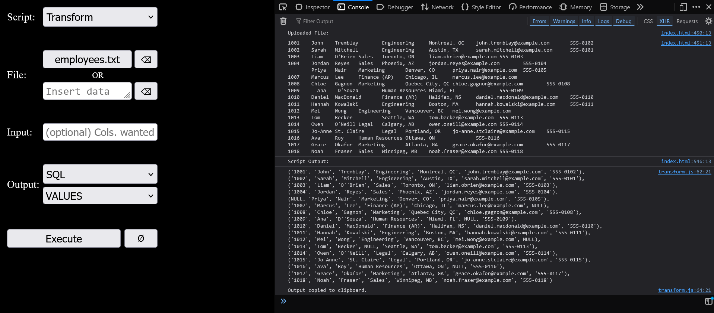

# ExSQL

A lightweight toolkit for the tedious data chores that come up around SQL work: turning Excel rows into `INSERT`/`IN` lists, pulling IDs out of logs, diffing two lists, finding duplicates. It runs as a single HTML page opened straight from disk. There's nothing to install, no build step, and no server.



## Why it exists

I built this during an internship where I was writing a lot of SQL and helping with system migration. The database was poorly documented, so lots of small questions ("which of these orders are missing from that table?", "which employee IDs appear twice?") meant writing throwaway queries or doing the work by hand in Excel.

The environment was locked down:

- no npm, no package installs, no downloads
- no terminal access
- an editor (Notepad++) and a web browser, nothing else

So I made the browser the runtime. The page is plain HTML and JavaScript, opened with `file://`, and each tool is a separate script that gets injected when you click **Execute**. Output goes to the browser's DevTools console and is copied to the clipboard, ready to paste into a query or a spreadsheet.

An example of real use: during the migration I had tons of employee records in Excel that needed to go into the new system. The `transform.js` script turned the Excel rows into SQL `VALUES` tuples that could be pasted straight into an `INSERT` query.

## Tools

| Tool | What it does | Typical use |
|------|--------------|-------------|
| **Transform** | Converts tab-separated rows (copied from Excel) into SQL `VALUES` tuples or an `IN (...)` list. Can pick and reorder columns. | Excel → `INSERT ... VALUES` |
| **Extract** | Pulls the value that follows a given prefix from every line, either by literal prefix or by your own regex. | Order numbers from scheduler error logs |
| **Filter** | Removes a list of values from your data, either whole entries or rows matched on one column. | "Everything except these IDs" |
| **Mismatch** | Compares two lists and shows what exists only in each one. | Reconciling source vs. target after a migration |
| **Duplicates** | Lists the values that appear more than once. | Checking a key column before loading |
| **Count** | Counts occurrences of a piece of text (case-insensitive). | Quick sanity checks on a file |
| **Replace** | Replaces every occurrence of one string with another. | Cleaning up delimiters |

Most tools can output in three formats:

- **SQL, `IN`:**
  ```
  ('a',
  'b',
  'c')
  ```

- **SQL, `VALUES`:**
  ```
  ('a'),
  ('b'),
  ('c')
  ```
  or multi-column tuples for tab-separated rows

- **Excel:** 
  ```
  a
  b
  c
  ```
  ready to paste back into a spreadsheet

SQL output escapes single quotes (`O'Brien` → `'O''Brien'`) and turns empty cells into `NULL`. The output is standard SQL and works in Postgres, MySQL, SQL Server, SQLite and Oracle 23ai+.

## Usage

1. Open `html/index.html` in a browser.
2. Open DevTools (F12) and switch to the **Console** tab. Output will be there.
3. Pick a tool from the **Script** dropdown.
4. Upload the data file **or** directly paste.
5. Fill in the inputs, pick an output format, and click **Execute**.
6. The result is printed in the console and copied to your clipboard.

### Input

Paste the data or upload any plain-text file (`.txt`, `.tsv`, `.log`, ...).

- **Transform, Filter, Mismatch and Duplicates** read Excel rows, a plain list (one value per line or comma-separated) or SQL output from this tool. An unquoted `NULL` counts as an empty value.
- **Extract, Count and Replace** work on any text.

The files in [`data/sample/`](data/sample/README.md) are realistic examples: an Excel export, a scheduler log and two ID lists. 

**Tip:** for large Excel sheets, use **Save As → Text (Tab delimited) (\*.txt)** and upload the file instead of pasting.

## Examples

Each example shows the data you paste in, the settings, and what gets copied to your clipboard.

<details>
<summary><b>Transform</b>: Excel rows → SQL</summary>

Turn Excel rows into SQL. Empty cells become `NULL` and apostrophes are escaped.

```
1001	John	Tremblay	Montreal, QC
1002	Sarah	Mitchell	Austin, TX
1003	Liam	O'Brien	Toronto, ON
	Priya	Nair	Denver, CO
```

**Output:** SQL, VALUES

```
('1001', 'John', 'Tremblay', 'Montreal, QC'),
('1002', 'Sarah', 'Mitchell', 'Austin, TX'),
('1003', 'Liam', 'O''Brien', 'Toronto, ON'),
(NULL, 'Priya', 'Nair', 'Denver, CO')
```

With **Columns:** `3,1`, only those columns are kept, in that order:

```
('Tremblay', '1001'),
('Mitchell', '1002'),
('O''Brien', '1003'),
('Nair', NULL)
```

</details>
<details>
<summary><b>Extract</b>: pull IDs out of a log</summary>

Pull the value after a prefix out of every line.

```
[INFO] job started
[ERROR] issue with Order: 4891493.
[WARN] slow response
[ERROR] issue with Order: 4828736.
```

**Input:** `Order: `    ·   **Output:** SQL, `IN`

```
('4891493',
'4828736')
```

In Minimal mode, the prefix is matched as literal text and trailing punctuation (like the period above) is dropped. RegEx mode takes a pattern such as `/issue with Order:\s(\d+)/g` and returns the first capture group.

</details>
<details>
<summary><b>Filter</b>: remove values or whole rows</summary>

Remove values from a list:

```
1001
1002
1003
1004
```

**Items to except:** `1002, 1004` · **Output:** SQL, `IN`

```
('1001',
'1003')
```

Or remove whole rows based on one column. With the Transform input above, **Items to except:** `('Montreal, QC', 'Denver, CO')` · **Column:** `4` · **Output:** SQL, `VALUES`:

```
('1002', 'Sarah', 'Mitchell', 'Austin, TX'),
('1003', 'Liam', 'O''Brien', 'Toronto, ON')
```

**Tip:** commas split the except list, so values that contain one are quoted SQL-style, as above.

</details>
<details>
<summary><b>Mismatch</b>: what exists in only one list</summary>

Compare two lists and show what's exclusive to each one.

**Data:** `1001, 1002, 1003` · **Match against:** `1002, 1003, 1009` · **Output:** SQL, `IN`

```
File/Inserted Data exclusives:
('1001')
Matcher input exclusives:
('1009')
```

</details>
<details>
<summary><b>Duplicates</b>: values that appear more than once</summary>

List the values that appear more than once.

```
1001
1002
1001
1003
1002
1001
```

**Output:** Excel

```
1001
1002
```

</details>
<details>
<summary><b>Count</b>: count a piece of text</summary>

Count occurrences of a piece of text, ignoring case. With the Extract input above, **Count:** `[error]` gives:

```
2 occurrences.
```

</details>
<details>
<summary><b>Replace</b>: swap one string for another</summary>

Replace every occurrence of one string with another.

```
a.lee@gmail.com
j.doe@gmail.com
```

**Find:** `@gmail.com` · **Replace with:** `@company.com`

```
a.lee@company.com
j.doe@company.com
```

</details>

## Chaining

Every tool's output can be pasted in as the next tool's input, in any order. For example:

- **Transform** (columns `1,3,5`, SQL `VALUES`) → **Filter** (column `3`, cities to drop) → rows ready for an `INSERT`
- **Mismatch** two ID lists → **Replace** `xyz-` with `XYZ-` → IDs ready for a query
- **Replace** `@gmail.com` with `@company.com` → **Transform** to SQL `VALUES`

**Tip:** if Mismatch finds exclusives on both sides, the output includes both labels. Copy just the list you need from the console.

## Project structure

```
html/index.html     The UI: tool picker, inputs, execution
html/app.js         Page logic: shows the right inputs, runs the selected tool
scripts/            One file per tool, injected into the page on Execute
parser/             Shared parsing and formatting helpers, loaded by index.html
boilerplate/        Starting template for a new tool
data/sample/        Fake data to try each tool on
```

### Limitations and improvements

The Limitations come from the environment the tool was built for, and I'd change a few things and add improvements in the future but keep it lightweight. 
